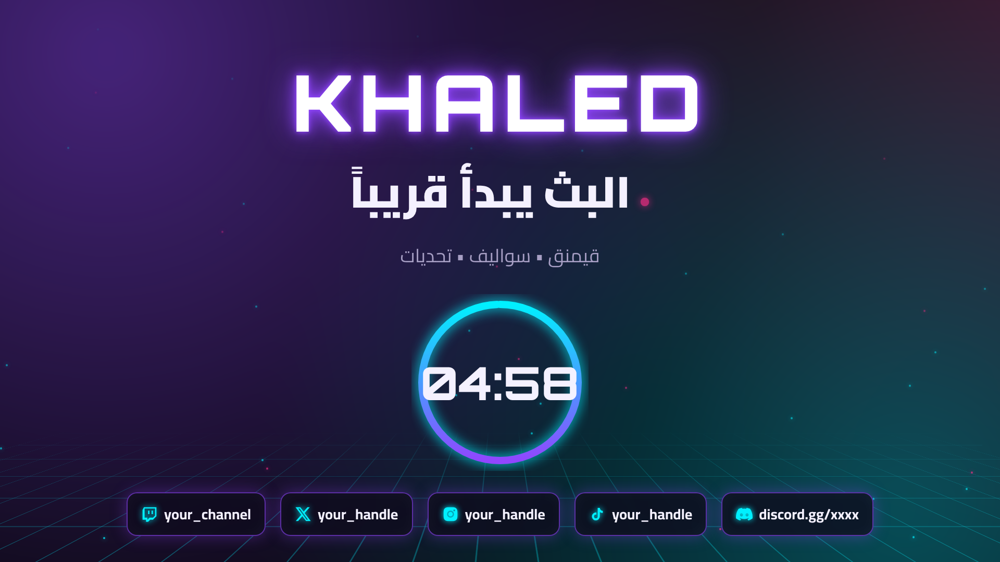

# 🎮 عدّة بث تويتش كاملة — نيون

كل شي تحتاجه لبث احترافي: شاشات، تنبيهات دونيشن حية، هدف تبرعات، شات، بانلات للبروفايل، ولوحة تحكم.

## 📁 الملفات

| الملف | الاستخدام في OBS | المقاس |
|---|---|---|
| `starting.html` | مشهد "البث يبدأ قريباً" + عد تنازلي (`?min=10` لتغيير المدة) | 1920×1080 |
| `brb.html` | مشهد "راجع بعد شوي" + شريط متحرك | 1920×1080 |
| `ending.html` | مشهد نهاية البث + آخر متابع وأكبر داعم | 1920×1080 |
| `ingame.html` | إطار الكاميرا + الشريط السفلي فوق اللعبة | 1920×1080 |
| `alerts.html` | تنبيهات المتابعة/الاشتراك/الدونيشن/الرايد مع صوت وكونفيتي | 1920×1080 |
| `goal.html` | شريط هدف الدونيشن | 900×160 |
| `chat.html` | شات تويتش مباشر (`?test=1` للتجربة) | 520×760 |
| `control.html` | لوحة تحكم (Dock داخل OBS) | — |
| `panels/` | صور البانلات الجاهزة لصفحة القناة | 640×200 |

## 🚀 خطوات التشغيل (15 دقيقة)

### 1) عدّل الإعدادات
افتح `config.js` وغيّر: اسم القناة، اسمك المعروض، الألوان، حساباتك، وهدف الدونيشن.

### 2) اربط الدونيشن (StreamElements — مجاني)
1. سجّل في **streamelements.com** بحساب تويتش.
2. فعّل صفحة التبرعات: **Revenue → Tipping** واربط PayPal أو Stripe.
   رابطك يكون: `streamelements.com/اسم_قناتك/tip` — حطّه في بانل "ادعم البث".
3. خذ التوكن: **Account → Channels → Show secrets → JWT Token** وحطّه في `streamElementsJWT` داخل `config.js`.
   ⚠️ التوكن سرّي: لا ترسله لأحد ولا ترفعه على GitHub عام.

### 3) أضف المشاهد في OBS
لكل ملف: **Sources → + → Browser** ← فعّل **Local file** ← اختر الملف ← اكتب المقاس من الجدول.

المشاهد المقترحة:
- **Starting Soon**: `starting.html` + `alerts.html` + `chat.html`
- **Gameplay**: Game Capture ← الكاميرا (480×270 أسفل اليسار) ← `ingame.html` ← `goal.html` ← `chat.html` ← `alerts.html` (الأعلى دائماً)
- **BRB**: `brb.html` + `alerts.html`
- **Ending**: `ending.html`

> ✅ فعّل "Control audio via OBS" في مصدر `alerts.html` عشان تتحكم بصوت التنبيه.
> `alerts.html` هي اللي تحفظ الإحصائيات، فلازم تكون موجودة في كل المشاهد.

### 4) لوحة التحكم
**Docks → Custom Browser Docks** ← الاسم: `تحكم` ← الرابط: مسار `control.html` (مثال: `file:///C:/overlay/control.html`).
منها تختبر التنبيهات، وتعدّل مبلغ الهدف، وتصفّر الإحصائيات قبل كل بث.

## 🎨 بانلات صفحة القناة
ارفع الصور من مجلد `panels/` في: **قناتك → About → Edit panels**. نصوص جاهزة:

**👤 من أنا**
> هلا والله! أنا KHALED 💜 أبث قيمنق وسواليف وتحديات. هدفي أسوي مكان ممتع للكل — حياك معنا.

**💰 ادعم البث**
> دعمك يساعدني أطوّر البث وأجيب أجهزة أفضل 🙏 كل دونيشن يظهر على الشاشة باسمك!
> 👉 streamelements.com/your_channel/tip
> ⚠️ التبرع اختياري تماماً وغير مسترد — وجودك بحد ذاته دعم.

**📜 القوانين**
> 1. الاحترام للجميع — ممنوع السب والعنصرية
> 2. ممنوع السبام والروابط بدون إذن
> 3. ممنوع حرق القصص (سبويلر)
> 4. قرار المشرفين نهائي
> 5. استمتع 😄

**📅 جدول البث**
> الأحد – الثلاثاء – الخميس | 9:00 م بتوقيت مكة 🕘

## 🤖 أوامر البوت (StreamElements → Chat bot → Commands)
| الأمر | الرد |
|---|---|
| `!donate` | 💰 ادعم البث: streamelements.com/your_channel/tip |
| `!discord` | 🎮 انضم لنا: discord.gg/xxxx |
| `!socials` | 📱 X: @your_handle • انستقرام: your_handle • تيك توك: your_handle |
| `!goal` | 🎯 هدف البث: مايك جديد — كل دعم يقربنا! |
| `!rules` | 📜 احترم الكل، لا سبام، لا سبويلر 💜 |

Timer كل 15 دقيقة: `💜 لا تنسى تتابع القناة عشان يوصلك تنبيه البث القادم!`

## 🏷️ عناوين بث جاهزة
- `🔴 بث مباشر | تحدي ما ينتهي إلا بالفوز 🔥 !donate`
- `🎮 سهرة قيمنق وسواليف مع الشباب | !discord`
- `⚡ رانكد للصباح — نوصل الهدف الليلة؟ 🎯 !goal`

## ⚙️ إعدادات OBS المقترحة
- **Output**: Encoder = NVENC H.264 (أو x264)، Bitrate = 6000 Kbps، Keyframe = 2
- **Video**: 1920×1080 → 1920×1080 (أو 1280×720 لو النت ضعيف)، 60 FPS
- **Audio**: 48kHz، أضف فلتر Noise Suppression للمايك
- **Stream**: Service = Twitch → Connect Account

## 🧪 التجربة بدون JWT
- `alerts.html?test=1` ← تنبيهات وهمية كل 11 ثانية
- `chat.html?test=1` ← رسائل شات وهمية
